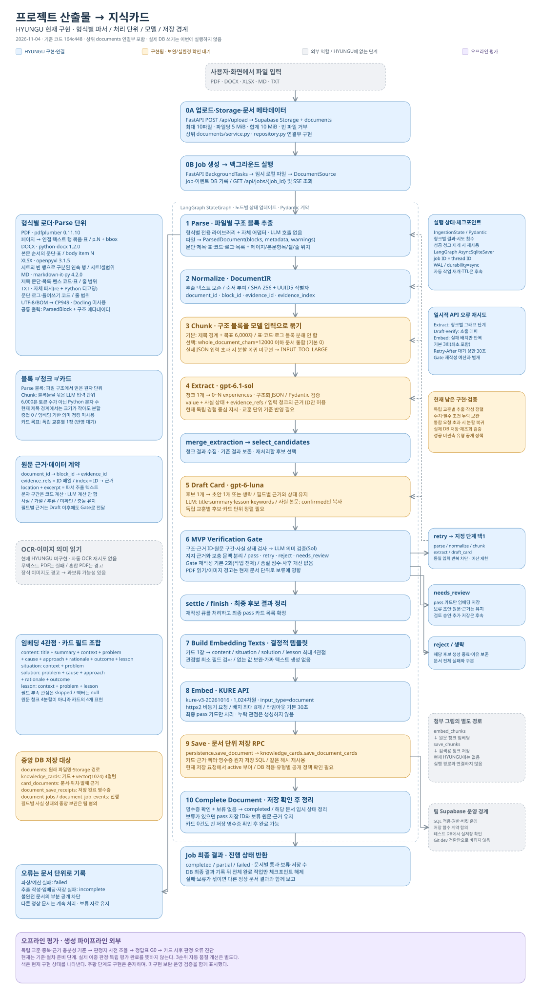

# HYUNGU 문서 지식카드 파이프라인 구조

2026-11-04, 기준 코드 `164c44842ff7ff022cd3c688a014024f42c793e1`.
현재 로컬 Python 코드와 일반 설정을 기준으로 작성했다. 파이프라인의 현재 동작을 설명하며,
평가 기준 문서에만 있는 정책을 구현 완료로 표시하지 않는다. 키·접속 비밀값은 포함하지 않는다.



[확대 가능한 SVG 원본](assets/pipeline_architecture.svg)

## 색과 범위

| 색 | 의미 | 예 |
|---|---|---|
| 파랑 | HYUNGU에서 구현·보완·연결한 코드 | Parse, Normalize, Gate, 임베딩, 상위 업로드·Job 연결 |
| 주황 | 구현은 있으나 추가 보완 또는 팀 합의·실환경 검증이 남음 | 교훈 단위 정렬, 통합 청킹, DB 저장 연결 |
| 회색 | 현재 HYUNGU에 없는 단계 또는 사용자/UI·팀 운영 경계 | OCR, 원문 청크 임베딩·저장, DB 적용 |
| 보라 | 생성 파이프라인 밖의 평가 준비 | 기준·정답표·판정자 조율·오류 진단 |

상위 업로드·Job 코드도 이전 작업에서 연결했으므로 구현 영역으로 표시했다.
첨부 그림의 `embed_chunks`와 `save_chunks`는 현재 HYUNGU 노드가 아니며 실제 흐름에 연결하지 않았다.
이 문서의 번호는 설명용이다. 실제 그래프에는 재처리·결과 보존용 보조 노드가 더 있다.

## 1. 파일을 읽는 도구와 Parse 단위

현재는 **형식별 전용 라이브러리와 자체 파서 어댑터**를 사용한다. Docling을 사용하지 않는다.
LangChain Document Loader나 RecursiveCharacterTextSplitter를 쓰는 구조도 아니다.
아래 버전은 이 컴퓨터의 `.venv`에서 확인한 설치 버전이다.

| 형식 | 도구 | Parse에서 만드는 블록 | 구조·위치 보존 | 한계 |
|---|---|---|---|---|
| PDF | `pdfplumber 0.11.10` | 페이지별 표와 텍스트 행을 얻고 인접한 같은 종류 행을 문단·코드·로그로 묶음 | `p.N / bbox x,y`, 페이지 번호·영역·표 행렬. 표 영역 텍스트를 본문에서 제외 | 표 탐지와 글꼴/크기 기반 분류는 휴리스틱. 복잡한 다단 배치·선 없는 표의 완전 복원 보장 없음 |
| DOCX | `python-docx 1.2.0` | 본문 순서의 문단 또는 표 하나. Heading/Code 계열 스타일로 제목·코드 분류 | `body item N`, 제목 계층, 표 행·열·병합 셀의 원점·중첩 표, 링크 | 실제 페이지 번호를 계산하지 않음. 임의 문단을 정밀한 화면 좌표로 추정하지 않음 |
| XLSX | `openpyxl 3.1.5` | 시트별로 빈 행을 경계로 나눈 연속 비어 있지 않은 행 묶음. 각 묶음은 표 블록 | `시트명!A첫행:마지막열마지막행`, 행 번호·열·셀 값·수식·하이퍼링크·병합 범위 | 고정 컬럼명·첫 행 헤더를 가정하지 않음. 수식은 문자열로 보존하며 계산하지 않음 |
| MD | `markdown-it-py 4.2.0` | CommonMark + table 확장의 최상위 제목·문단·목록·펜스 코드·표 토큰 | 원래 줄 범위의 텍스트, 제목 경로, 코드 언어·표 행렬 | 하위 목록 항목마다 무조건 독립 블록을 만드는 방식은 아님 |
| TXT | Python 디코딩 + `re` 자체 파서 | 빈 줄 기준 문단, `#` 제목, 들여쓰기 코드, 로그·Traceback 묶음 | 원래 줄 범위·순서, 섹션 경로 | 일반 텍스트에 구조 정보가 없으면 규칙으로 추정. 로그는 빈 줄이 있어도 문맥에 따라 유지 |

텍스트 인코딩은 `utf-8-sig`를 먼저 시도해 일반 UTF-8과 BOM을 함께 처리하고, 실패하면 CP949를 시도한다.
Parse는 LLM을 호출하지 않는다. 출력은 `ParsedDocument(blocks, metadata, warnings)`다.

파일 선택·빈 파일·바이트/압축 해제 한도 검사는 [parsers/__init__.py](parsers/__init__.py),
실제 파서는 [PDF](parsers/pdf.py), [Office](parsers/office.py), [MD·TXT](parsers/text.py)에 있다.
직접 파서 입력의 기본 한도는 50 MiB·압축 해제 200 MiB·시트 20만 셀이며,
제품 업로드의 5 MiB/파일 제한과 다른 내부 자원 한도다.

### 이미지 PDF와 경고

- 글자가 없는 페이지는 `TEXT_UNAVAILABLE:p.N` 경고로 남기고, 모든 페이지에서 텍스트가 없으면 실패한다.
- 이미지가 있는 텍스트 페이지는 `IMAGES_NOT_TRANSCRIBED:p.N` 경고를 남긴다. OCR/비전 호출은 없다.
- 현재 Gate의 evidence_checker는 해당 문서에 경고가 있으면 그 문서의 근거에 `INCOMPLETE_SOURCE`를 붙인다.
  경고 영향을 해당 페이지로만 한정한 구현은 아니다. 작은 로고도 문서 전체 카드의 보류에 영향을 줄 수 있다.
- 파싱 노드로 재처리하더라도 현재 없는 OCR 기능이 생기지는 않는다. 자동 이미지 복구 경로는 미구현이다.

## 2. Normalize와 근거 계약

[normalization.py](normalization.py)는 파서가 얻은 텍스트를 바꾸지 않고 순서를 부여한다.
블록 내용·메타데이터의 SHA-256과 문서 ID 기반 UUID5로 `block_id`, `evidence_id`를 재현 가능하게 만든다.

```text
DocumentSource(document_id, original_filename, path)
  → ParsedDocument(형식별 구조 블록)
  → DocumentIR(공통 블록 + 순서 + evidence_index)
  → Chunk(그 블록들을 묶은 모델 입력)
```

`evidence_refs`는 근거 ID 배열이고 `evidence_index`는 ID에서 EvidenceRef를 찾는 맵이다.
각 근거는 document_id·block_id·location·excerpt를 갖는다. 현재 정규화는 블록 전체를 인용하며
문자 구간은 `0:len(block.text)`로 코드가 계산한다. 스키마는 문자 구간 생략도 허용한다.
excerpt는 파서가 추출한 텍스트이며 PDF 파일의 원본 바이트나 완벽한 화면 복원을 뜻하지 않는다.
LLM에 ID·페이지 좌표·정확한 문자 인덱스를 생성시키지 않는다.

## 3. Chunk의 실제 단위

[chunking.py](chunking.py)는 공통 DocumentIR의 구조 블록을 순서대로 묶는다.

| 항목 | 현재 동작 |
|---|---|
| 기본 목표 | `target_chars=6000`. Python 문자 수의 소프트 목표이며 토큰 수가 아님 |
| 제목 경계 | `section_path`가 달라지면 길이와 무관하게 기존 묶음을 닫음. 작은 청크도 생김 |
| 같은 섹션 | 다음 블록을 더하면 목표를 넘는 경우 앞 묶음을 닫음 |
| 원자 블록 | 큰 표·코드·로그 블록 내부를 다시 자르지 않음. 단일 블록도 6000자를 넘을 수 있으며 `oversized`로 표시 |
| 헤딩 처리 | 같은 제목 경로에서 제목과 첫 후속 블록을 가능한 한 유지. 크기 목표가 절대 상한은 아님 |
| 중첩/의미 청킹 | overlap 없음. 임베딩·LLM 기반 의미 경계 탐지 없음 |
| 소문서 통합 | `whole_document_chars`를 양수로 주고 블록 연결 길이가 그 이하면 한 청크. 기본값은 0 |
| 실험 값 | 12000은 비교에 사용한 값. 모든 문서의 고정 기본값이 아님 |
| 요청 초과 | 통합 후 JSON·프롬프트를 포함한 입력이 초과하면 `INPUT_TOO_LARGE`. 섹션 분할로 자동 복귀하지 않음 |

따라서 **Parse 단위는 구조 블록, Chunk 단위는 구조 블록 묶음, 카드 목표 단위는 독립 교훈**이다.
청크 1개가 카드 1장을 뜻하지 않으며, 파일 1개가 항상 하나의 LLM 입력이 되는 것도 아니다.

## 4. 노드별 기술·입출력·처리 상태

실행 조립은 [graph.py](graph.py)의 LangGraph StateGraph,
상태 계약은 [state.py](state.py), 데이터 검증은 Pydantic 모델을 사용한다.
설정 기본값과 확인한 로컬 일반 설정은 OpenAI 공급자, Extract/Verify `gpt-6.1-sol`,
Draft `gpt-6-luna`다. Ollama/Anthropic은 명시적 설정으로 교체할 수 있다.

| 단계 | 기술과 현재 동작 | 입출력 단위·주의 |
|---|---|---|
| 상위 업로드 | FastAPI `POST /api/upload`, python-multipart, Supabase SDK. Storage 원본 + documents 저장 | 최대 10파일, 파일당 5 MiB, 합계 10 MiB, 0바이트 거부. 원래 파일명 보존 |
| 상위 Job | BackgroundTasks, 임시 로컬 파일, DB Job·이벤트, SSE StreamingResponse | 업로드가 실행을 등록. SSE 연결은 실행을 새로 시작하지 않음. 조회 경로는 `/api/jobs/{job_id}`와 `/events` |
| Parse/Normalize/Chunk | 위 형식별 도구 + 자체 함수, Pydantic | LLM 없이 구조·원문 위치·근거 ID 준비 |
| prepare_extraction / extract | 청크별 워커 + OpenAI SDK 구조화 응답 + Pydantic. 입력 청크의 근거 ID만 허용 | 청크 하나에서 0~N experiences. 필드별 value/status/evidence_refs. 입력 밖 ID는 거부 |
| merge_extraction / select_candidates | 청크별 결과 수집, 이전 결과·재처리 대기열 보존 | 문서 전체의 독립 교훈을 의미적으로 통합·중복 제거한 단계라고 해석하지 않음 |
| draft_card | Luna가 title/summary/lesson/keywords 작성. 나머지 본문은 코드가 confirmed 값만 복사 | 추출 후보당 초안 1개 또는 생략. 원래 source_extraction·필드별 근거 유지. 파생 교훈은 inferred |
| verify | 구조·근거·인용 구간·사실 상태의 코드 검사 후 Sol 의미 검증 | pass/retry/reject/needs_review. 잘못된 필드를 자동 삭제하고 active로 만드는 방식이 아님 |
| settle / prepare_retry / finish | 경험별 판정 정리·재처리 큐·이전 결과 복원 | 지정된 parse/normalize/chunk/extract/draft_card 단계로 제한적으로 복귀. 같은 입력 반복 차단 |
| build_embedding_texts | `card-views-v1` 결정적 필드 템플릿. LLM 호출 없음 | 최종 pass 카드당 최대 4개 관점. 최소 요건 미달 관점은 skipped |
| embed | KURE HTTPS API, httpx2 AsyncClient, 모델·인덱스·차원·유한 수 검사 | `kure-v3-20261016`, 1024차원, 문서 입력, 최대 8개/배치, 타임아웃 30초. 키는 도표에 넣지 않음 |
| save | pipeline 어댑터 → knowledge_cards service → Supabase RPC | 문서 단위 카드·근거·벡터·저장 영수증. 실제 DB 적용·실저장 검증은 별도 확인 필요 |
| complete_document | 문서별 영수증·해시·카드 수 확인, 완료된 임시 상태 정리 | 보류 자료 유지. 0건도 빈 영수증을 확인하면 completed 가능 |
| 상위 Job 결과 | 문서별 상태·실패·저장 수를 DB 기록 후 SSE/조회로 반환 | completed/partial/failed. 모든 문서 완료와 최종 결과 기록 뒤 Job 체크포인트 해제 |

LLM 요청은 프롬프트와 직렬화 payload를 포함해 기본 48000자 검사, 호출별 출력 4096토큰 설정이다.
정확한 글자 수 검사는 `len(instructions) + len(json.dumps(payload, ensure_ascii=False))`이며,
공급자에 보내는 JSON 스키마·메시지 포장까지 포함한 토큰 계산기는 아니다.
모델 공급자 전환은 설정으로 명시하며 실패했다고 다른 유료 공급자로 자동 전환하지 않는다.
현재 Extract 프롬프트의 ‘독립 경험’을 독립 교훈별 후보로 정렬하는 작업은 남아 있다.
평가 기준 문서가 생성 프롬프트를 자동으로 바꾸지는 않는다.

동기 파싱과 Storage/DB SDK 호출은 `asyncio.to_thread`로 옮기는 연결이 있다.
SSE는 Last-Event-ID 이후 이벤트를 재생하며 기본 15초 keepalive를 사용한다.
30분 동안 갱신되지 않은 queued/running Job은 조회 시 중단 상태로 처리하는 코드가 있다.
이것이 프로세스 중단 뒤 백그라운드 작업을 자동 복구하는 워커라는 뜻은 아니다.

## 5. Gate와 재시도·보존

- 규칙 검증은 필수이고 LLM 의미 검증은 현재 기본 활성화다.
- 지지 근거와 추가 문맥은 구분한다. 문맥은 기본 12000자 예산이며 전체 LLM 요청 한도도 유지한다.
  추가 문맥을 입력해도 그것이 자동으로 해당 필드의 지지 근거가 되지는 않는다.
- `context_missing`은 실제 문맥 확장 전략 없이 같은 분할을 반복하지 않고 보류한다.
- Gate 내용 재작성은 기본 작업 전체 2회다. 일시적 API 오류의 호출 재시도와 다른 예산이다.
- Extract는 청크별 진행 기록을 유지하며 기본 최대 3회(최초 포함), Draft/Verify는 RetryingGenerator,
  Embed는 서비스의 현재 실패 배치에서 기본 최대 3회다. 이미 성공한 배치를 같은 루프에서 다시 호출하지 않는다.
- Retry-After의 대기 상한은 30초다. 인증·잘못된 입력은 무의미하게 반복하지 않는다.
- 제품 Job은 LangGraph AsyncSqliteSaver, job ID를 thread ID로 사용하고 WAL·busy_timeout·sync 내구성을 사용한다.
- 같은 thread의 체크포인트 재개와 새 작업 제출은 다르다. 제품이 프로세스 재시작 뒤 자동 작업 재개를 제공하는 것은 아니다.
  보류 이력 TTL·다중 호스트 저장소·추가 승인 진입점은 후속 계약이다.

## 6. 네 가지 임베딩의 정확한 조합

| 관점 | 조합 필드 | 최소 조건 |
|---|---|---|
| content | title + summary + context + problem + cause + approach + rationale + outcome + lesson | title·summary·context·lesson + problem/cause/approach/rationale/outcome 중 하나 |
| situation | context + problem | context·problem |
| solution | problem + cause + approach + rationale + outcome | problem·approach |
| lesson | context + problem + lesson | context·problem·lesson |

없는 선택 필드는 넣지 않으며 최소 조건이 안 되면 그 관점을 생성하지 않는다.
관점별 가짜 벡터·0벡터를 만들지 않는다. 네 관점은 동일 카드의 검색 표현이며 원문을 4개로 나누는 것이 아니다.
현재 필드가 보존된 카드가 대상이고, 원문 Chunk 전체에 대한 임베딩 경로는 별도로 구현돼 있지 않다.

## 7. 저장·공개와 팀 경계

현재 호출 경로는 다음과 같다.

```text
get_graph → save 노드
  → persistence.save_document(DocumentSaveRequest)
  → knowledge_cards.service.save_document_cards(dict)
  → save_document_cards RPC → SaveReceipt 대조
```

- `documents`, `knowledge_cards`, `card_documents`, `document_save_receipts`가 연결된다.
  진행 정보는 `document_jobs`, `document_job_events`에 저장하는 코드가 있다.
- 코드와 SQL은 문서별 원자 저장·같은 document_id/payload_hash 재사용·다른 해시 거부를 의도한다.
  실제 DB의 트랜잭션·동시성 보장은 SQL 적용 후 확인할 항목이다.
- 초안의 status는 draft다. 현재 어댑터는 최종 pass 카드의 저장 요청에 active를 부여한다.
  Gate 자체가 DB 상태를 변경하지 않으며, Embed 전에 active DB 카드가 있어야 하는 구조가 아니다.
- pass와 needs_review가 섞이면 pass만 저장하고 문서는 needs_review + saved_card_ids로 남긴다.
  보류 초안·근거·원문 IR을 정리하지 않는다. 보류만 있으면 빈 저장으로 완료 처리하지 않는다.
- 추출/Draft가 불완전한 문서의 부분 공개는 차단한다. 분류한 오류는 문서별로 기록하고 다른 문서를 처리한다.
  처리하지 못한 예외는 상위 Job 오류가 될 수 있다.
- 카드 0건은 실패와 동일하지 않다. 정상 처리 후 0건 영수증이 있으면 완료될 수 있다.
- 보류 추가 승인·카드별 멱등 저장, 필드별 사실 상태/근거 링크의 중앙 영속 저장은 팀 협의 대상이다.
- 성공 관측 없는 유형의 정답표 포함과 공개 승인은 별개다. 유형별 측정 후 공개 정책을 정하는 결정은
  현재 저장 코드에 유형별 분기로 구현된 상태가 아니다.

상세 계약은 [저장 연결 계약](../../knowledge_cards/STORAGE_CONTRACT.md),
[팀 연결 계약](regulations.md)을 참고한다. GitHub dev는 코드 통합 브랜치이며 DB 대상은 설정으로 정한다.

## 8. 첨부 그림과 현재 코드의 차이

| 첨부 그림의 표현 | 현재 HYUNGU |
|---|---|
| Parse 뒤 바로 Chunk | Normalize/DocumentIR 단계가 별도로 있음 |
| 문서 전체에서 Extract | 기본은 청크별 호출. 소문서 통합 옵션이 적용된 경우에만 그 문서 전체 블록을 한 번에 전달 |
| 못 읽은 문서가 하나라도 있으면 카드 경로 생략 | 문서별 실패 격리. 정상 문서는 계속하며 불완전한 문서만 공개 보류 |
| Verify가 문제 필드 제거·공개 상태 결정 | 근거·주장을 검증하고 통과/재작성/거절/보류. 본문을 임의로 삭제해 통과시키지 않음 |
| active만 임베딩, draft는 별도 유지 | 최종 Gate pass 초안이 대상. active는 저장 요청에서 부여 |
| embed_chunks → save_chunks | 현재 HYUNGU 미구현·미연결. 회색 참고 영역으로 표시 |
| 저장 카드나 검색 문서가 없으면 failed | 정상 0건도 저장 확인 후 completed 가능. 원문 검색 가능 여부로 Job 성공을 결정하지 않음 |

이 구조도 작업은 문서·그림 작성이다. 실제 파이프라인 코드·모델·환경·DB는 변경하거나 실행하지 않았다.
